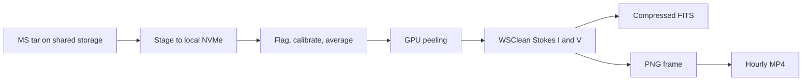

# GPU Subband Imaging

Distributed OVRO-LWA snapshot imaging across a small GPU cluster. One control
process schedules independent subband batches over SSH and records progress in
SQLite, so interrupted runs can resume.



CPU preprocessing, GPU peeling, and image archiving overlap within each batch.
A failed batch is logged and retried without stopping other subbands.

## Requirements

- Python 3.8+
- `python-casacore`, CASA tasks, NumPy, Astropy, and PyYAML
- WSClean, AOFlagger, CFITSIO `fpack`, and FFmpeg
- Julia, CUDA, and TTCalX
- Passwordless SSH from the control host to each worker
- Shared input, calibration, state, and output paths

Install the Python package in the prepared runtime environment:

```bash
python -m pip install -e .
export GSI_WORKER_SH="$PWD/workers/run_worker.sh"
```

## Configure

Copy `examples/config` to a local, untracked directory and edit all paths and
node names:

```bash
cp -R examples/config config-local
```

- `cluster.yaml`: nodes, GPUs, worker limits, state, and scratch paths
- `subbands.yaml`: image size and pixel scale by frequency
- `pipeline.yaml`: date, inputs, calibration, peeling, imaging, and movies

The default Lustre write guard only allows
`/lustre/pipeline/snapshots_gpu_pipeline`. Set
`GSI_ALLOWED_LUSTRE_WRITE_ROOT` before launch to use another Lustre output tree.

## Run

```bash
gsi dry-run --config "$PWD/config-local"
gsi run --config "$PWD/config-local"
gsi status --config "$PWD/config-local"
gsi resume --config "$PWD/config-local"
```

Products are written under:

```text
<output_root>/<band>MHz/<date>/<hour>/fits/*.fits.fz
<output_root>/<band>MHz/<date>/<hour>/<band>MHz_<date>_<hour>UTC.mp4
<output_root>/_metadata/<date>/run.json
```

Movie PNGs include the snapshot's UTC date/time and a `Jy/beam` color scale.
They live in the hour's `images/` directory and are removed after a successful
stitch when `movie.keep_frames` is `false`. The metadata JSON records the code
revision, frozen configuration, calibration paths, processing parameters, and
final ledger summary.

For unattended daily runs, see `scripts/run_daily_allsubbands.py`. Deployment
notes are in `deploy/README-deploy.md`; the scheduler design is in
`docs/DESIGN.md`.

## Automation

`scripts/run_daily_allsubbands.py` waits for a successful calibration, writes
the date-specific configuration, and runs continuously across dates.
`scripts/run_cosmology_backfill.py` processes matching archived dates with the
earliest successful same-date calibration. Both launchers use a shared lock so
only one run controls the GPU cluster at a time. Data, calibration, output,
date, hour, and state paths can be overridden from the command line.

`examples/config/` is the daily-run template. Copy it, replace the site paths
and nodes, then launch:

```bash
cp -R examples/config config-daily
python scripts/run_daily_allsubbands.py \
  --date YYYY-MM-DD --template config-daily --output-config config-auto
```

## Peeling safeguards

Before peeling, workers sample the calibrated visibility data and skip snapshots
that are effectively empty. Catalog sources below the configured elevation
limit are left in the image, and unconverged, nonfinite, or extreme-gain
solutions are rejected rather than subtracted. Source elevations and solve
decisions are recorded in the worker logs.

The defaults live under `peel` in `pipeline.yaml`: 30x3 peeling with a 15 degree
source elevation limit, `1e-2` convergence tolerance, required convergence,
maximum gain amplitude of 100, and a 1 percent minimum nonzero visibility
fraction.

## CPU-TTCal-matched zesting (sky + RFI)

The `peel` section can also select a zest that reproduces the CPU pipeline's
`ttcal.jl zest` (sky) and `ttcal_dev` (RFI) results. It needs TTCalX with
`solve_gains!` (branch `feature/cpu-matched-zest`) in `env.ttcalx`. The
defaults above keep the original GPU peeling.

```yaml
cal:
  rfi_sources: /path/to/rfi_43.2_ver20251101.json

peel:
  solver: rk4                    # CPU TTCal's solver: RK4, per-channel convergence
  maxiter: 5
  tolerance: 1.0e-4
  minuvw: 5.0
  min_source_elevation_deg: 0.0
  require_convergence: false
  model: exact                   # CPU TTCal's sky model
  uvw: geometric                 # precessed ITRF baselines
  flag_model: true               # flagged data out of both sides of the solve
  resubtract: true               # keep the last accepted solution on rejection
  fast_io: true                  # faster MS read/write, same result
  rfi: true                      # zest cal.rfi_sources after the sky
```

The main pipeline runs the RFI zest on every band, although the RFI model
has flux only at 14.8-40.9 MHz. Above that the RFI direction still acts as
an extra free gain direction (it lowered the 69 MHz image rms by ~15% in
tests), so keep `rfi: true` on all bands to reproduce the main pipeline, or
switch it off per band with `peel_overrides` (e.g. `46: {rfi: false}`).

Further options: `rfi_mode: joint` zests the RFI emitter together with the
sky sources; `guard: true` reverts a source update that raises the residual
power; `reg_max_offset_deg` (with `reg_taper_deg`, `reg_lambda`) adds a
Tukey phase prior on the gains; `device: cpu` runs TTCalX on CPU threads
(`JULIA_NUM_THREADS`, default `auto`). The daemon logs
`ZEST_TIMING read=… peel=… write=…` for every snapshot.

## Snapshot astrometry: J2000 UVW (`fix_uvw`, default `centroid`)

The raw OVRO-LWA snapshot MSes label PHASE_DIR J2000 (the geocentric zenith at
TIME_CENTROID), and their stored `w` is exact for it, but the stored (u, v)
axes are rotated about `w` by ~0.34 deg (2026; 0.335-0.350 deg over
2026-10-24 10h).  WSClean uses UVW as given, so without the fix every snapshot
image is rotated by that angle about its centre (~15-19' at 40-60 deg from
zenith).  After averaging, `stages/uvw.py` recomputes UVW with casacore
measures for the MS's own PHASE_DIR (~0.1 s per snapshot):

* `centroid` (default): at TIME_CENTROID, where PHASE_DIR and the stored `w`
  agree (no rephasing).  The raw TIME is the integration start, 5 s earlier.
* `time`: at TIME, like `chgcentre` (and the main pipeline), with the `w`
  change applied to the data; images then match the main pipeline exactly,
  which is 5 s of Earth rotation (~75" in RA) behind the sky.
* `off`: keep the stored UVW (old behaviour).

`uvw.fix_uvw(ms, dry_run=True)` reports how far an MS's UVW are from J2000.

## CLEAN snapshots, kept MSes and hourly images (optional, default off)

```yaml
# pipeline.yaml
imaging:
  mode: clean              # dirty (default): one -pol IV -niter 0 run
                           # clean: orca SNAPSHOT_CLEAN_I_PARAMS for I (clean_* keys) + dirty V
keep_ms_root: /lustre/.../keep   # move peeled MSes to <root>/<band>MHz/<date>/<hour>/<stamp>.ms
hour_imaging:                    # used by `gsi hour-image`
  ttcalx_image: /path/to/venv/bin/ttcalx-image   # TTCalX python/ttcalx_imager
  products: [I-Deep-Taper-Robust-0, I-Deep-Taper-Robust-0.75, I-Deep-NoTaper-Robust-0.75,
             I-Deep-NoTaper-Robust-0, I-Taper-10min, V-Taper-Deep, V-Taper-10min]
# cluster.yaml defaults
archive_workers: 2         # parallel image+archive threads per GPU slot (default 1)
```

`gsi hour-image --config ...` (after `gsi run`) images each band-hour of kept MSes on one GPU
slot into `<output_root>/<band>MHz/<date>/<hour>/hour_images/` (main-pipeline file names, a
`<band>MHz-summary.json` from the imager and `<band>MHz-hour-timing.json`). The keep root must
be inside the Lustre write guard; `GSI_ALLOWED_LUSTRE_WRITE_ROOT` accepts several roots
separated by `:`. `GSI_TASKSET_CPUS`, `GSI_NICE` and `GSI_IONICE` (e.g. `0-23`, `10`,
`-c2 -n7`) pin and deprioritise the remote workers and all their children.
